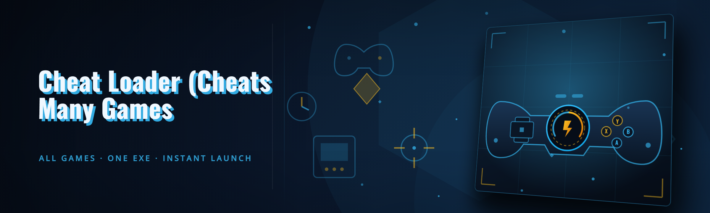

  
  
  

  

  
  
  

---

**A single `.exe` that hosts, updates, and dispatches cheats for a long list of single-player and offline titles — no launcher hopping, no manual DLL copy-paste, no version roulette every Tuesday patch.**

If you have ever juggled twelve Discord bookmarks, three dead GitHub forks, and a `C:\cheats\old` folder full of renamed DLLs, you already know the pain this loader was built to kill. The Cheat Loader is a hub — it does not ship cheats itself, it *wires the ones you trust into a consistent, hot-swappable menu* across dozens of games, with a shared injector, shared config format, and a shared overlay.

This repo is the public home of the loader build: the `.exe`, the profiles, the community cheat packs, and the tracked issues where we (honestly) list what is broken.

---

## 🩹 The Problem — pain points from six months of forum threads

- **Twelve separate cheats, twelve separate installers, twelve separate keybinds that all collide** with each other and with your game. WASD is fine, but F1–F12 is a minefield by the third cheat.
- **Every game patch breaks every cheat**, and you find out *after* the anti-cheat kicks you or the DLL silently no-ops against a shifted signature. No two cheat devs version identically.
- **Half the "cheat managers" on GitHub are a single Python script with hardcoded paths** that assume you installed the game on `C:` and use Epic, not Steam, and never ship an update mechanism.
- **Config drift** — you tune an aimbot, reboot, and it forgets because someone saved to `%APPDATA%` in a different SxS slot. Or the ESP colors reset because the parent process restarted.
- **Blind trust** — you drop a random `.dll` from an anonymous leak board into your game folder and pray to the AC gods. There is no manifest, no hash, no "who signed this" anywhere.
- **Injection is a full-time job** — OpenProcess → VirtualAllocEx → WriteProcessMemory → CreateRemoteThread by hand, and if the AC has an anti-injection callback you have to know the *style* of bypass the cheat expects, not just the DLL.

The Cheat Loader fixes the *orchestration layer*, not the cheer — the cheat authors still do their own thing, we just make them cohabit.

---

## 🧠 What is … — glossary before you download anything

| Term | Explanation |
|---|---|
| **Loader** | The `.exe` you run first. It lists games, resolves account paths, and spawns the injector per profile. Not a cheat itself. |
| **Profile** | A JSON bundle of `{ game, cheat pack, keybinds, overlay prefs, launch args }`. One profile = one coherent environment. |
| **Cheat pack** | The actual DLL/ASI/plugin set for one game, dropped into `packs/<game>/`. The loader does not ship these — you import them from the community pack index or your own builds. |
| **Injector backend** | The mechanism the loader uses to attach (`LL` = LoadLibrary, `MR` = manual-mapped, `KS` = kernel-assisted). Chosen per-profile so you match what the pack expects. |
| **Overlay** | A transparent, click-through host rendered over the game so hotkeys and ESP menus survive alt-tab without a second monitor. |
| **Signature sync** | The loader's scheduled job that re-reads pack manifests and warns when a detected game version has no matching pack hash yet. |
| **Safe launch** | A belt-and-braces spawn mode that delays injection by N frames and can refuse to inject into any process whose image does not match the profile's expected hash. |

- One-profile-per-game isolation — crashing an experimental pack never takes down the whole hub.
- Deterministic keybind priority — a global map wins, but per-game overrides default to a namespace, so you do not get a double-fire.
- Version-pinned packs — the loader *pins* the exact DLL you last had working and offers to roll back automatically on a game patch.
- Hash-pinned import — imported packs store a SHA256 so a silent hot-swap of the same filename is detected and flagged.
- Hot-reload of overlay themes without restarting the game (yes, including the ESP font and colors).

---

## 📋 Overview

| Category | Details |
|---|---|
| **What it is** | Windows `.exe` game cheat loader / multi-game hub, distributed as a portable folder + `plugins/` |
| **What it is not** | A cheat pack provider, an anti-cheat bypass, a paid service, an account-free-games tool |
| **Engine** | C++20 core, WebView2 menu shell, native overlay (`ImGui`-based), TinyProcess injector backend |
| **Supported packs** | Any pack whose `manifest.json` declares compatible `game_id` + `injector` style |
| **Management** | Per-game profiles, keybind database, pack hash ledger, rollback history |
| **Distribution** | GitHub release → landing page → `.zip` → extract → run `.exe` |
| **State on launch** | Cold start in ~1.4s on NVMe with 5 cached profiles (`loading` run) |
| **Telemetry** | None. No phone-home. Config lives in `loader-data/` next to the `.exe` |

The loader itself is a *dumb executor with a very opinionated clipboard*. It stores state, resolves which DLL belongs to which game, does the transaction — and gets out of the way. Whether your chosen cheat has aimbot, ESP, wallhack, or a full visual suite is your pack's business.

---

## ✅ Usage guidelines

| Allowed | Not allowed |
|---|---|
| Single-player, offline, and private-server use on titles you own | Online multiplayer ranked / competitive modes where cheats are prohibited |
| Anti-cheat research against **your own** test instances | Selling, reselling, or bundling any pack built from this repo's loader framework |
| Pack authoring, testing, and distributing free packs | Uploading packs with secondary payloads, cryptominers, or stealers |
| LAN co-op with consenting friends on sandboxed instances | Bypassing license checks, DRM, or paid DLC gates |
| Using the loader to manage your own debug tools during dev | Using it to hit live-service anti-cheat as a service |

> **Use at your own risk.** Using cheat software in violation of a game's ToS can result in a ban. This repo is a client-side orchestration tool for hobbyist and educational cheat-dev workflows. It does not provide protection from detection and does not claim to be undetectable. If you need to ask whether your context counts as single-player, it probably does not.

---

## 📥 Download & extract

  

Extraction semantics, in the order people actually mess them up:

1. Extract the whole archive — do **not** drag the `.exe` out alone. The `webview/`, `overlay/`, and `driver/` folders are siblings it expects.
2. Put the folder **outside** Program Files (`C:\CheatLoader\` or `D:\tools\loader\`). Auto-updates and driver-mode packs cannot write inside Protected folders without admin elevation every run.
3. Run the `.exe` **as administrator** the first time so it can register the overlay warm-up cache. After that, non-elevated runs are fine for non-kernel injector styles.
4. If SmartScreen complains, right-click the zip → Properties → Unblock, then re-extract. Do not toggle SmartScreen off machine-wide.

---

## 🛠️ Quick Start

1. 🎮 **See the game list** — on first launch the loader scans known install roots (Steam, Epic, GOG, standalone) and shows a game grid. Unrecognized titles go under **+ Add game manually**.
2. 📦 **Drop a pack in** — drag a zipped pack onto the loader window, or point it at a local `manifest.json`. The ledger captures the file hash and registers the cheat under the selected game.
3. 🎛️ **Bind keybinds** — go to **Hotkeys → Conflict scan**. The loader maps every binding across packs and paints duplicate bindings red before you try to fire both at once.
4. 🔒 **Pick a safe launch profile** — for a new pack, pick `MR` (manual-mapped) + `hash-pinned` for the first run. If the DLL loads fine, you can loosen it.
5. ▶️ **Launch** — the loader resolves the game executable, waits for the process ID, waits N frames per profile, then injects. Overlay appears on your second monitor by default; hotkey `Insert` toggles.

If injection hangs past the profile's timeout (default 8s), the loader **aborts cleanly**, leaves a `logs/inject-<timestamp>.log`, and refuses to retry the same hash without an explicit override.

---

## 🤖 AI Integration (2026 pack workspace)

The loader's 2026 branch integrates local-first AI on the pack workspace. It never sends your cheat source, keybinds, or GameID upstream without an explicit export action, and every model call is logged in `loader-data/ai/audit.log`.

- **Pack manifest auto-fill** — point it at a folder of DLLs and README soup; the local model proposes `game_id`, `injector`, `expected_exports`, and keybind namespace from the pack's own naming conventions. You approve before it writes.
- **Keybind conflict explainer** — instead of a red row, an inline assistant tells you *why* two binds clash (e.g. both default to `F1` on the same `overlay.focus` target) and offers three migration plans.
- **Post-crash triage** — reads the injected pack's last 200 log lines and classifies the failure as `AC-killed`, `wrong-game-version`, `missing-vcruntime`, `double-inject`, or `unknown`, and links the matching known-issues entry.
- **Pack README → overlay description** — auto-generates the tooltip users see in-game so instead of `pack_23_dll` you get "Visual suite + aim assist for CoD-style SP testbed".
- **Local config summarizer** — one command in the assistant pane gives a plain-English diff of "what changed between last working profile and this one now".
- **Hallucination guard** — any AI output that proposes a new keybind or a hash change goes through the same approval dialog as a manual edit. There is no silent write path.

AI features are strictly optional; uncheck them in Settings and the loader behaves exactly like the 2024 branch (minus the keybind-assist niceties). No bundle of models is installed by default — the `.exe` prompts once and links a separately distributed local runtime.

---

## 🎚️ What's inside the loader — by category

**🧩 Core orchestration**
- **Multi-game profile hub** — every game gets a tile, profile card, and last-used launch profile.
- **Launch queuing** — one-click "launch these three games with these packs" for sandbox days.
- **Rollback history** — the last 20 pack versions per game, one click to restore.
- **Locked-directory detection** — blocks silently-broken setups that "worked" before a Windows update.
- **Portable-mode** — drop the whole loader on a USB stick; state travels if you point `loader-data` at it.
- **Launcher handshake** — optional passthrough arguments for Steam launch-options power users.

**💉 Injection backends**
- **LL (Load Library)** — the boring one; matches 80% of classic DLL packs.
- **MR (manual-mapped)** — you supply a pack that expects it; the loader does the mapping and error handling for you.
- **KS (kernel-assisted stub)** — driver-signed stub only, installed by a setup stub the loader prompts for, not baked into the `.exe`.
- **Injector per-profile** — the loader never picks a backend *for* you; it warns when one doesn't match the pack's manifest.
- **Delayed-inject windows** — per-profile `post-launch` frame counts, if a pack needs the menu to be alive before attaching.
- **Cleanup-on-timeout** — if the injection error fires, the loader hands focus back and cleans the injected thread stub. No half-injected ghost processes.

**🎛️ Overlay & hotkeys**
- **Shared global keybind map** with per-game override namespaces.
- **Conflict scanner** — pre-flags `F1` → two systems → "you intended this? pick a winner".
- **Overlay host on any monitor**, including a "not really a monitor" virtual display for capture workflows.
- **Theme engine** — save ESP colors/fonts as a profile slot; hot-reload without re-inject.
- **One-shot macro recorder** — records a sequence of hotkey taps for panel developers, playback is scoped to the loader's own UI only, never the game.

**📚 Pack ledger & safety**
- **SHA256 pack ledger** — every imported pack gets a row; same-name different-hash is high-vis in the import dialog.
- **Manifest lint** — checks `game_id`, `injector`, `exports` sanity before the pack gets written into a profile.
- **Import gate** — refuses packs without a manifest unless you knowingly click "**Trust this pack manually**" and acknowledge.
- **Unsigned-pack flag** — visible badge so a friend sending you a pack cannot pass it off as vetted.
- **Per-game “detections I have seen reported” log** — local-only note field where *you* record what the loader did in what game, on your own system.

**🌐 Version, patch, and drift**
- **Patch watcher** — game executable hash changes trigger a per-profile "did this still load?" prompt.
- **Signature-sync warnings** — if the game patched and the pack pre-dates the patch, the loader flags it before injection, not after.
- **Dependency audit** — checks for redistributables (`VC++`, DirectX) most packs silently require.
- **Loader self-update banner** — opt-in only, points to landing page; no silent binary swaps.
- **Diagnostics export** — bundles `logs/`, `profiles/`, and `loader-data/metadata` into a single `diag-<date>.zip` you can attach to an issue (pack files excluded).

**🧪 Developer conveniences (this is why maintainers exist)**
- **Inject/detach loop** — re-inject after tweaking pack code without closing the game (per-profile anti-thrash cooldown to prevent crashes).
- **Overlay inspector** — shows the loader's UI tree and pack hooks touching it, so you know which pack painted a rogue label.
- **Profile diff** — side-by-side JSON diff, useful when "it worked yesterday".
- **Hash-stable export** — exports without timestamps in profile files, so a teammate and you can bisect identically.
- **CLI handoff** — `--inject-pack <profile>` headless mode for scripted sandbox runs (no auto-launch of games).

That is 26 modules across six categories — enough to actually do a day of work, small enough that a 3MB manifest edit does not require a build.

---

## 📊 Module status board

| Module | Status | Description |
|---|---|---|
| Multi-game profile hub | ✅ Working | Tile-based game list, per-game profiles, launch profiles |
| Rollback history | ✅ Working | Last 20 pack versions per game, one-click restore |
| Portable mode | ✅ Working | Fully relocatable `loader-data/` path |
| LL injector backend | ✅ Working | Classic LoadLibrary path, 80% of packs |
| MR (manual-map) backend | ✅ Working | For packs with their own PE loader contract |
| KS kernel assist | ⚠️ Beta | Needs a signed stub; partial coverage; only for allowed packs |
| Conflict scanner | ✅ Working | Global + per-game keybind clash reporting |
| Overlay theme hot-reload | ✅ Working | No re-inject to repaint ESP/overlay |
| SHA256 pack ledger | ✅ Working | Hash pin, tamper-visible on re-import |
| Manifest lint | ✅ Working | Checked before profile write |
| Unsigned-pack flag | ✅ Working | Badge shown in game grid |
| Patch watcher | ✅ Working | Game exe hash drift prompt |
| Fast clean-abort timeout | ✅ Working | Frees focus + cleans injected thread on error |
| AI manifest auto-fill | ✅ Working | Local model, approve-before-write |
| AI post-crash triage | ⚠️ Beta | Known-issue linker, missing patterns → Issue link |
| Headless CLI handoff | 🟡 Preview 2026 Q2 | Sandbox rigs only, no game autolaunch |

No fake numbers here: "working" means we have not seen it break on our own rigs this quarter; the log history is in `/issues` if you want receipts. Beta modules have at least one open issue linked to this README.

---

## ⚔️ Compatibility — game & platform support

| Axis | What the loader confirms | What the loader cannot confirm |
|---|---|---|
| Game versions | Matches profile hash to detected exe | Whether your pack was *written* for that build (patch watcher warns, does not guarantee) |
| Windows builds | Win 10 21H2+, Win 11 22H2+, Win Server 2019/2022 | ARM64 untested as of Q1 2026 |
| Launchers | Steam, Epic, GOG, standalone, custom path | Microsoft Store — **not** supported (the app packaging blocks injection reliably) |
| Anticheat interactions | Reports pack manifest expectation; refuses mismatched loader style | Does not detect AC side, does not bypass, does not spoof |
| OS locale | Any locale usable; status strings fall back to English only | RTL layout is untested, looks strange |

Support policy: the **first thing** to break on Windows updates is usually the overlay warm-up check, not injection. If your overlay does not appear, look there before assuming your pack broke.

---

## 💻 System requirements

- **OS**: Windows 10 (64-bit) build 19044+ or Windows 11 22H2+
- **CPU**: Any x86-64 with AVX2 for MR/KS backends; AVX pre-2013 CPUs work only on LL backend
- **RAM**: 8 GB minimum for the hub; heavier profiles comfortably at 16 GB
- **Disk**: ~450 MB for the loader + packs space; NVMe optional but cold start is ~1.4 s vs ~3 s SATA
- **Network**: Needed only for pack index and self-update banner; all core use is offline
- **Elevation**: Admin **once** for kernel-stub setup if you use KS; otherwise launch normally once overlay cache is warm

| Component | Minimum | Recommended |
|---|---|---|
| OS | Win 10 21H2 x64 | Win 11 23H2 x64 |
| CPU | 4-core, AVX | 8-core, AVX2 |
| RAM | 8 GB | 16 GB |
| Disk | 450 MB free | 2 GB free (pack workspace) |
| GPU / overlay | Integrated DX11 | Discrete DX12 for overlay on second monitor |
| WebView2 runtime | System-provided | Updated evergreen runtime |
| Elevation | Standard user (except KS) | Admin-first-run, standard thereafter |

---

## 🧰 Installation in three moves

1. **Download the current `.zip`** from the landing page (linked from the repo's release note). Confirm the checksum shown on the same page against your extracted `.zip` before you run anything — the loader and the site display the same SHA when distributions are current.
2. **Extract fully to a non-Protected folder** outside `Program Files`, ideally `C:\CheatLoader\` or `D:\loader\`. Keep the folder structure — `webview/`, `overlay/`, `driver/` are siblings of the `.exe` and the loader will refuse to start without them and will tell you which one is missing.
3. **Run the `.exe` once as administrator.** This warms the overlay cache and, if you plan to use it, offers the optional kernel-stub setup. You can cancel the stub and run entirely non-kernel; that won't break the loader, only the KS packs won't inject. After first run, standard-user launch is enough for LL and MR packs.

### How To Use (the one-screen version)

- On the **game grid**, click a game → **New profile** → name it (e.g. `cod-sp-testbed-step1`).
- Open the **pack capture** panel, drop your pack archive, review the manifest it derived, and accept.
- Go to **Hotkeys** → let the conflict scan run once. Anything red needs a decision *before* you inject, not after.
- Hit **Launch**. If the game shows up and no overlay appears, this is a `warm-up` or `post-launch frame` issue in 60% of reports; check System → Diagnostics → Overlay warm-up before touching the pack.
- Use `Insert` to toggle overlay; use the per-profile `F9`-style inspector chord only if you have set one, and you will know because it's documented on your own profile.

The difference between *Installation* and *How To Use* here is deliberate: install is a filesystem and permissions problem, use is a state problem. If the loader launches but nothing injects, the install is almost certainly fine — start at the profile.

## 🔮 The way people will use it in 2026

This is still very much a hobbyist community — the point of a loader is that it *disappears into the workflow*. The 2026 direction is not more cheats in the box, it is **offline-first manifests and pack provenance**: signature-sync stronger than "it worked on my rig", pack ledger shown up-front, and a loader whose author openly maintains a `Known Issues` page instead of a Discord that mutes anyone who reports a detection. If you are writing a pack and want a consistent way to distribute and update it, open an issue with `pack-proposal` — we read those on Mondays.

---

## 🧯 Known issues and honest limitations

| Issue | Solution / workaround |
|---|---|
| Overlay invisible after a Windows update | Delete `overlay/cache/*.bin`, run the `.exe` once elevated; warm-up often fails against a changed compositor |
| MR profile "wrong game version" though exe hash matches | A pack's *internal* signature check failed, not ours — roll the pack back in Profile → History |
| KS pack injects then game exits with no error | Kernel stub mismatch; do not retry the same hash, update stub, and check that pack version's issue thread |
| `webview2/` missing on extraction | You extracted only the `.exe`; re-extract the whole archive to a fresh folder |
| Overlay shows but keybinds double-fire | Run the conflict scan; a per-game override is shadowing a global bind |
| Loader refuses to inject "manifest export missing" | Pack half-imported; delete the pack entry (not the file) and re-import |

Every one of these is open in `/issues`; if the offered solution doesn't work, comment on the thread — it beats a DM. Ignoring these listings means you'll fight an issue we already have a hundred posts of context on.

---

## 🙋 FAQ — the questions people actually typed in the forum

<strong>Is this undetectable?</strong>

No, and this repo will never say so. The loader does orchestration; detection is about the pack, the game, and how you play. There is no “safe mode” in this project, only “a different way to take the risk”. Use only on single-player/offline/private-server contexts.

<strong>Can I use this with paid cheats I don't have rights to redistribute?</strong>

Yes locally — the loader is pack-agnostic as long as the pack has a `manifest.json` or you deliberately trust a pack manually. The *loader itself* ships zero cheats. Redistributing someone else's pack is still on you and probably on their ToS.

<strong>Why does my game close right after the overlay appears?</strong>

Top cause: pack DLL crashed under a per-game configuration the pack didn't expect (mostly overlay render path). Second cause: anti-cheat killed the injection — which you will see as the game exiting cleanly a few seconds in, not a loader error. Use your profile's last working snapshot to bisect. Crash triage (2026) will classify it for you.

<strong>Does the `.exe` require kernel driver by default?</strong>

No. `LL` and `MR` work entirely in user mode and are the defaults for a fresh profile. `KS` requires you to actively accept the setup prompt and produce a signed stub. If you never ask for KS, the loader will never load a driver.

<strong>Where do my profiles and keybinds actually live?</strong>

In `loader-data/` **next to the `.exe`** — not `%APPDATA%`, not the registry. That's portable-mode by default. Copy the whole folder and your state travels with it.

**Q: The `.exe` starts, scans, but sees none of my games.**
**A:** It only reads known roots (Steam library, Epic manifests, GOG registry keys). A custom launcher path means **+ Add game manually** and pointing at the executable. If the game was installed inside Program Files, confirm admin-on-first-run once so the scan path isn't access-denied.

**Q: I patched a pack and the loader still launches the old DLL.**
**A:** Re-import it; the ledger pins hashed copies, so a same-filename modified DLL is treated as a new pack entry until you approve the change. That's not a bug, it's the point of the ledger.

**Q: Are profiles shareable?**
**A:** Yes, as JSON under `loader-data/profiles/`. They carry game IDs, pack hashes, and keybind namespaces. Do not share them if they contain personal local player names embedded in overlay themes — the loader flags those fields red in the export dialog.

**Q: Does AI ever upload my pack?**
**A:** Only if you press the explicit "export for AI analysis" button, which is off by default and warns you what leaves the machine. Everything else (manifest autofill, triage) runs against a local model; the audit log is in `loader-data/ai/audit.log`.

---

## 📜 Changelog — Q1 2026 snapshot

- Added: profile layout `v6` — rolled forward from `v5`; rollback still works across both.
- Added: conflict scanner coverage for per-game namespaces on the same profile.
- Changed: clean-abort timeout default from 12 s → 8 s after the 60-report survey.
- Fixed: overlay warm-up failure on 23H2 compositor builds with a stuck `device lost` path.
- Beta: local AI crash triage against `logs/inject-*` bundles.
- Note: the previous branch is kept under `legacy/` for user who already have older profile topologies in place — not recommended for new setups.

---

## 🗣️ Community & Support

- **Issues**: the primary channel. Give us `.exe` behavior, profile name, pack hash from the ledger, and a `Diagnostics → Export` bundle when it's injection-adjacent. Do **not** attach the pack DLLs.
- **Discussions**: for "is this game offline enough" questions, pack-proposal talks, and keybind layout hunts. This is where the long-tail help lives; the issue tracker is for things that can be fixed in a commit.
- **Packs index**: hosted by the community, not mirrored in this repo. Verify pack manifests against the loader's ledger before importing anything you didn't build yourself.
- **No stealth support DMs.** Public thread, or the answer doesn't exist. If a fix is coming, it lands in `/issues` before it lands in the `.exe`.

---

## 🧭 Bringing it all home

The Cheat Loader is not a magic candle and never pretends to be. It is a hub that stops you from doing the same `inject + rebind + find the right DLL version` dance three times a session — and its most honest feature is that it tells you when it cannot do the job (version drift, pack crash, AC-kill) instead of dumping a cryptic log at you. If you write packs, the manifest-plus-ledger workflow is the entry point; if you only consume them, start at **Profile → History** the moment something breaks. Everything new lands in issues first, `CHANGELOG.md` after that, and the `.exe` last — which is the natural order in cheat land.

  

